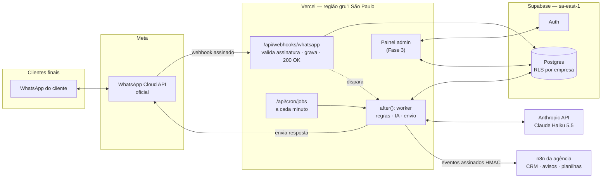
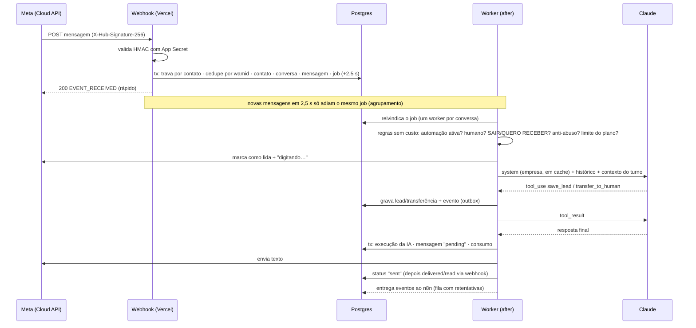

# 1. Arquitetura tecnológica

## Visão geral



## Decisões e alternativas avaliadas

| Tema | Escolha | Por quê | Alternativas descartadas |
|---|---|---|---|
| Canal WhatsApp | **WhatsApp Cloud API oficial (Meta), direto** | Hospedagem gratuita pela Meta; respostas dentro da janela de 24h são gratuitas; sem risco de banimento do número. | **Bibliotecas não oficiais** (Baileys, WPPConnect e similares): violam os termos e podem causar o banimento do número do cliente. **BSPs** (Twilio etc.): cobram uma taxa por mensagem por cima do preço da Meta. Fazem sentido só se o cliente já tiver contrato com um. |
| Modelo de IA | **Claude Haiku 5.5** como padrão, configurável por plano e por agente (Sonnet 5.5 e Opus 5.5 disponíveis) | Pelo nosso perfil de tokens, sai cerca de 3× mais barato que o GPT-5 mini (ver [custos](02-custos.md)). Tem cache de prompt, uso de ferramentas com schema estrito e contexto de 1M. Um único provedor simplifica contrato, LGPD e suporte. | **OpenAI GPT-5 mini**: viável, mas mais caro no nosso perfil. A interface `LlmClient` permite adicioná-lo depois, sem reescrever o pipeline. **Sonnet/Opus como padrão**: 20 a 40× mais caros, e atendimento comercial não exige esse nível. |
| Orquestração do atendimento | **Código TypeScript** (Next.js Route Handlers) | O núcleo exige idempotência, trava por conversa, isolamento entre empresas, testes automatizados e versionamento. Fazer isso em fluxo visual é frágil. | **n8n no caminho crítico**: cada mensagem viraria uma execução, o isolamento ficaria por conta de quem monta o fluxo, testar é difícil e fica mais um ponto de falha. |
| Automações por cliente | **n8n** (da agência) recebendo **eventos assinados** | É o que o n8n faz melhor: CRM, planilhas, avisos a vendedores, e-mails. Monta-se sem deploy. | Integrar cada CRM em código no MVP (lento e caro). |
| Banco, autenticação e fila | **Supabase (Postgres)**, com o próprio Postgres servindo de fila (`SKIP LOCKED` + lease) | RLS isola as empresas no próprio banco e o Auth fica pronto para o painel. Região São Paulo. Fila sem Redis/SQS = menos serviços para pagar e manter. | Redis/BullMQ, SQS, Supabase Queues: só valem a pena quando o volume justificar (Fase 5). |
| Hospedagem | **Vercel Pro** (região `gru1`) | Deploy por git e `after()` para processar depois de responder à Meta. O Cron a cada minuto serve de rede de segurança. | Servidor próprio (mais manutenção). O plano Hobby **proíbe uso comercial**. |
| Base de conhecimento | **Conteúdo da empresa inteiro no prompt de sistema, em cache** | Base de PME típica tem de 2 a 30 mil tokens. Com cache, a leitura custa 10% do preço, e mandar tudo é mais preciso que RAG (não há "busca que não achou"). Existe um limite de tamanho validado no cadastro. | RAG com embeddings: entra na Fase 5, só para clientes com bases grandes (pgvector). |

## Fluxo de uma mensagem



## Isolamento entre empresas

O isolamento é feito em camadas, para que uma falha numa delas não exponha dados de outra empresa:

1. **Roteamento**: o `phone_number_id` do webhook identifica o canal e, a partir dele, a empresa (índice único `type + external_id`).
2. **Todas as tabelas têm `tenant_id`**, e as chaves estrangeiras compostas `(tenant_id, id)` impedem, no próprio banco, que uma conversa aponte para um contato ou canal de outra empresa.
3. **RLS** no schema `public`: usuários do painel só leem e alteram a própria empresa. Esse comportamento está coberto por [testes](../tests/integration/rls.test.ts).
4. **Schema `private`**, não exposto pela Data API: tokens criptografados, filas e eventos.
5. **Ferramentas da IA** recebem empresa, contato e conversa do contexto do servidor, nunca dos argumentos do modelo. Nem uma mensagem maliciosa (prompt injection) consegue alcançar outra empresa.
6. **Credenciais por canal**: AES-256-GCM com chave mestra em variável de ambiente.
7. **Limites por plano**: respostas/mês e teto de custo de IA/mês, por empresa.

## Confiabilidade

| Risco | Tratamento |
|---|---|
| A Meta reenvia o webhook | Dedupe por `wamid` (índice único), dentro da transação. |
| Cliente manda 3 mensagens seguidas | Debounce de 2,5 s (`REPLY_DEBOUNCE_MS`): uma única resposta para o conjunto. |
| Dois processamentos simultâneos da mesma conversa | Advisory lock + lease (`locked_until`): um worker por conversa. |
| Função cai no meio (timeout, deploy) | A resposta é gravada como `pending` antes do envio (outbox) e o cron reenvia. Um job travado volta para a fila quando o lease expira. |
| IA instável (429/5xx) | O job volta para a fila com backoff exponencial (15 s → 15 min, até 5 tentativas). Na última, o cliente recebe a mensagem de contingência e a conversa vai para um humano. |
| Recusa de segurança da IA | Mensagem de contingência + transferência (motivo `sensitive_topic`). |
| Token do WhatsApp inválido | A mensagem fica como `failed`, o canal vai para `error` e a falha aparece no monitoramento. |
| Loop ou abuso de custo | No máximo 4 iterações de ferramenta por resposta. Anti-abuso por contato (10/min, 150/dia) e teto mensal por empresa. |
| Endpoint do n8n fora do ar | 8 tentativas com backoff. Os eventos ficam no banco (`private.events`). |

## Estrutura do código

```
src/
  app/api/            # rotas HTTP: webhook do WhatsApp, cron, health
  server/
    ai/               # prompt, ferramentas, loop do agente, preços, cliente da Anthropic
    db/               # acesso a dados (SQL tipado, sempre filtrado por tenant_id)
    pipeline/         # ingestão, processamento da conversa, fila, eventos, regras
    whatsapp/         # assinatura, parser do webhook, cliente da Graph API
    tenant-config/    # cadastro de empresa/canal/webhook (usado pelos scripts e, na Fase 3, pelo painel)
    lib/              # cripto, logs com mascaramento, horários, texto
supabase/migrations/  # esquema, RLS e planos (compatível com o Supabase CLI)
scripts/              # CLI de operação: migrar, cadastrar empresa, conectar número, simulador
tenants/              # configurações de clientes (exemplo: odontovita.json, fictício)
tests/                # unitários + integração com Postgres real
```

## Limitações conhecidas (planejadas para as próximas fases)

- **Atendimento humano**: a conversa transferida fica pausada para a IA e a equipe recebe o evento (pelo n8n), mas ainda não há caixa de entrada para responder pelo painel. Isso vem na Fase 3. Até lá, o atendente usa o link `wa.me` do evento a partir de outro aparelho, ou responde quando a pausa expirar.
- **Áudio e imagem**: o agente pede para o cliente escrever. Transcrição de áudio e leitura de imagens (o Claude lê imagens) ficam para a Fase 4.
- **Mensagens iniciadas pela empresa** (lembretes, follow-ups) exigem templates aprovados pela Meta. Entram na Fase 4.
- **Instagram e chat do site** já estão previstos no modelo de dados (`channels.type`) e entram depois do WhatsApp.
