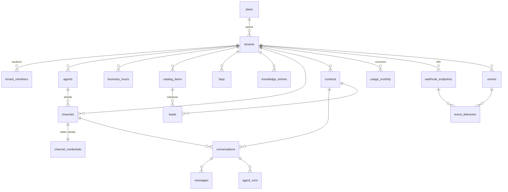

# 4. Estrutura do banco de dados

Postgres (Supabase). Fonte da verdade: [`supabase/migrations`](../supabase/migrations).

- `public`: exposto pela Data API do Supabase **com RLS** (usado pelo painel na Fase 3).
- `private`: **não exposto**. Credenciais, fila e eventos, acessados só pelo backend.

## Tabelas

| Tabela | Para quê | Pontos importantes |
|---|---|---|
| `plans` | Planos comerciais | `monthly_ai_replies`, `monthly_ai_budget_usd_micros`, `max_channels`, `features` (jsonb), `ai_model`, `ai_effort` |
| `tenants` | Empresas clientes | `slug` único, `status` (onboarding/active/suspended/canceled), `limits_override`, fuso, contato, `privacy_policy_url` |
| `tenant_members` | Usuários do painel por empresa | papéis `owner`, `admin`, `agent`, `viewer` (Supabase Auth) |
| `private.platform_admins` | Equipe da agência | acesso a todas as empresas |
| `agents` | Persona e regras do agente | tom, saudação, instruções, regras comerciais, pode/não pode informar, gatilhos de transferência, perguntas de qualificação, mensagens de transferência e contingência, modelo/esforço, limite de tamanho da resposta |
| `business_hours` | Expediente | vários intervalos por dia (ex.: pausa para almoço) |
| `catalog_items` | Serviços e produtos | `price_type`: `fixed`, `starting_at` (a partir de) ou `on_request` (sob consulta), duração |
| `faqs`, `knowledge_entries` | Base de conhecimento | entram no prompt em cache. O tamanho é validado no cadastro |
| `channels` | Números de WhatsApp (depois Instagram/site) | `external_id` = `phone_number_id` (roteamento), status e último erro, para monitorar a integração |
| `private.channel_credentials` | Token de acesso | AES-256-GCM na aplicação |
| `contacts` | Pessoas atendidas | único por empresa + canal + `wa_id`. `marketing_opt_out_at` e `privacy_notice_sent_at` (LGPD) |
| `conversations` | Sessões de atendimento | `open` (IA), `human` (pausada até `handoff_until`), `closed` (após 24h sem mensagens). Uma ativa por contato e canal |
| `messages` | Histórico completo | `external_id` (wamid) único para idempotência, `seq` para ordem estável, status de entrega |
| `agent_runs` | Cada resposta da IA | modelo, tokens (entrada/saída/cache), custo em micro-dólares, ferramentas, latência, erro |
| `leads` | Oportunidades | um lead aberto por contato, temperatura, qualificação, etapa (`new` → `qualified` → `contacted` → `won`/`lost`) |
| `usage_monthly` | Consumo agregado por mês | respostas, mensagens, tokens, custo, leads, transferências, marcas de aviso/limite |
| `webhook_endpoints` (+ `private.webhook_endpoint_secrets`) | Destinos de eventos (n8n) | só HTTPS público, eventos assinados |
| `private.events`, `private.event_deliveries` | Outbox de eventos | entregas com tentativas e último erro |
| `private.jobs` | Fila de trabalho | um job aguardando por referência (debounce), lease, tentativas, backoff |

## Regras de integridade que protegem o negócio

- `unique (tenant_id, id)` nas tabelas-pai + FKs compostas: **é impossível**, mesmo por bug, ligar uma conversa ao contato de outra empresa.
- Índice único parcial `conversations (tenant_id, channel_id, contact_id) where status <> 'closed'`.
- Índice único parcial `leads (tenant_id, contact_id) where stage not in ('won','lost')`.
- Índice único parcial `jobs (kind, ref_id) where status = 'queued'`. Novas mensagens só adiam o job (agrupamento).
- CHECKs em todos os enums, preços não negativos e horários coerentes.

## Tabelas previstas para as próximas fases

| Fase | Tabelas |
|---|---|
| 3 — Painel | `audit_logs` (quem alterou o quê), `data_requests` (pedidos LGPD de exportação/exclusão) |
| 4 — Automação | `calendar_integrations`, `appointments` (com `starts_at`, status, lembretes), `message_templates` (templates aprovados na Meta), `follow_up_rules` e `follow_up_runs` (sempre respeitando `marketing_opt_out_at`), `lead_stages` personalizáveis |
| 5 — Escala | `knowledge_chunks` com `vector` (pgvector) para bases grandes, particionamento de `messages` por mês |
| 6 — Comercial | `subscriptions`, `invoices` (depois de escolher e validar o provedor de pagamento) |
